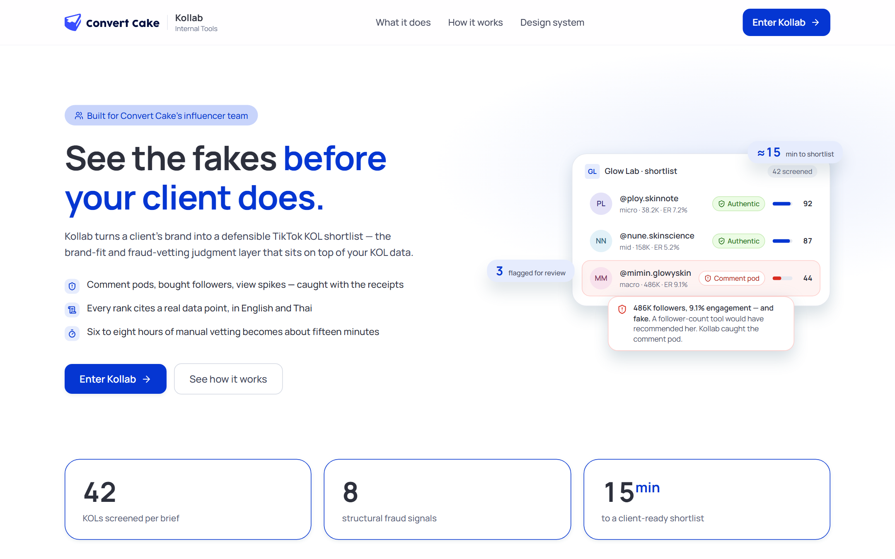
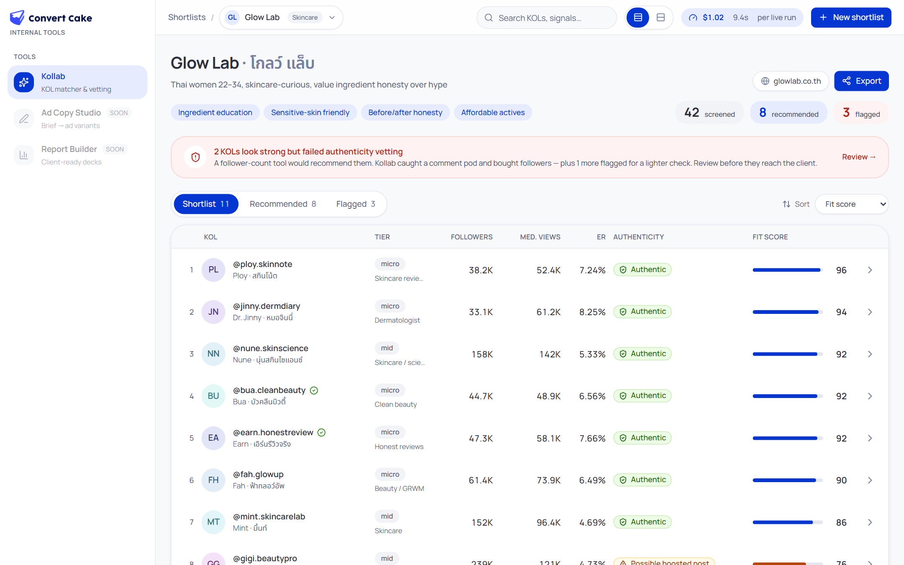
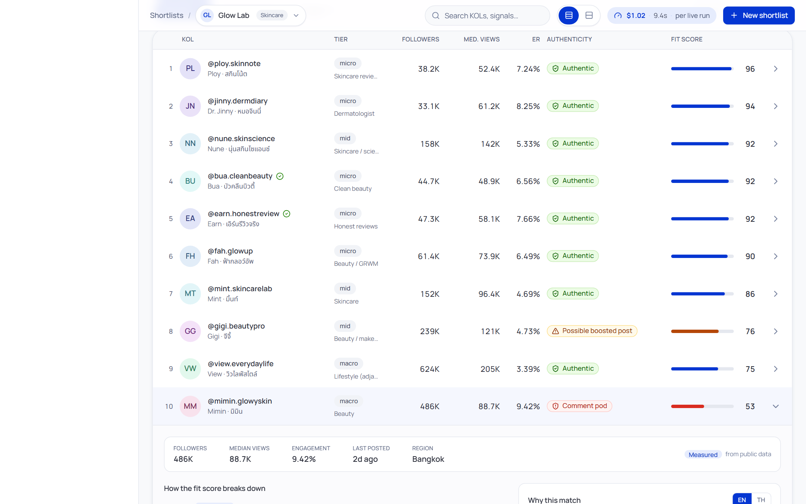
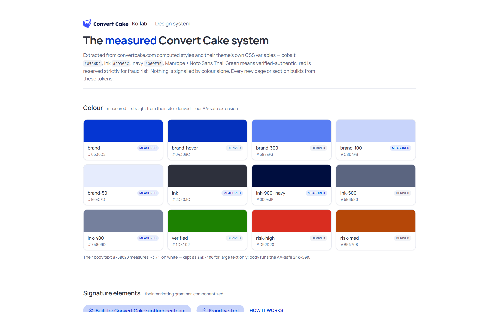

# Kollab — the judgment layer for Thai TikTok KOL matching

**Not a scraper, not a database — the brand-fit and vetting brain that turns a licensed KOL feed into a shortlist an account manager can defend to a client.**

🟢 **Live demo:** https://kollab-64c.pages.dev &nbsp;·&nbsp; wired to the live FastAPI backend (Render) + Neon — a real auth gate (sign in or one-click guest), live Brand-DNA extraction (Claude), and a per-user workspace. The seed shortlist renders the pipeline's own committed output (`/api/shortlist`): a real result in <60s.

> Built for Convert Cake's influencer team as an AI-Engineer take-home. `KOL + Collab = Kollab`.

| | |
|---|---|
|  |  |
|  |  |

---

## The problem

Agencies don't lack KOL *data* — licensed Thai platforms (Tellscore, AnyMind, TikTok Creator Marketplace) already hold tens of thousands of vetted profiles with demographics scraping can't get. They lack the **judgment layer**: turning a client's brand into a defensible, fraud-screened, ROI-justified shortlist an account manager can screen-share to a client unedited.

A follower-count tool recommends the 486K-follower creator with 9.1% engagement. Kollab catches that her engagement is a **41-account comment pod** and a **6.2× view spike over her own baseline** — *before* the client's budget bleeds into her.

## What it does

A 7-step pipeline, each output tagged with provenance and grounded to a real data point. The live paths switch on with API keys and **degrade honestly without them** — an unavailable path answers a clear 4xx/503 or a labeled fallback, never a fabricated result:

1. **Brand DNA** — `POST /api/brand-dna` turns a client website into a structured brief via **Claude → Gemini → rules-based skeleton**, every response naming its source and flagging degraded extraction (with no keys you get the honestly-labeled skeleton). The demo ships a curated brief with editable, persisted account-manager overrides.
2. **Candidate sourcing** — via a swappable `KOLSource` adapter. `SeedDatasetSource` (curated, always-on demo) or `ApifyAdapter` (public-data sampling, prototyping only): a **budget-capped actor-run loop** over unit-tested actor→model mappers. The account manager picks a **run depth** (Scan ≈ $0.28 / Standard ≈ $1.33 / Deep ≈ $3.20, or custom volumes) with a transparent cost estimate, an editable hard cap the loop stops *before* crossing, and an honest note on which signals can fire at that depth — the min-cohort rule, priced out loud (`GET /api/run-plans`). Supply `APIFY_TOKEN` and POST a brief (`?preset=deep`) to run it; the first live run is a calibration run. **Expand runs never buy the same data twice:** `?expand=1` skips every creator the brand already holds (run-history store) *before* any spend, filling the slots with new creators — `excludedKnown` reports the dedup. Production target = a licensed feed behind the same interface.
3. **Enrichment** — profile + recent videos + captions → content DNA, every derived field carrying a provenance tag (measured / inferred), and every inferred field an advisory that travels with the data: *"do not quote to client as fact."*
4. **Authenticity / fraud vetting (the hero)** — structural-first signals, graded against a pre-computed reference cohort, each badge naming the triggered signal and the distribution (with *n*) it was measured against. See below.
5. **Explainable match** — deterministic, citation-grounded factor scoring always; with a key, an **LLM rerank** rewrites the top-of-list why-copy but may only cite enumerated data points (`[[dp:*]]`) and must pass a post-hoc validator — uncited claims are rejected and the deterministic copy stays. Embedding retrieval for recall at licensed-feed scale is *(roadmap)*.
6. **Brand-safety + commercial-conflict gate** — two named checks, flag-for-human (never silent auto-exclude), each trigger routed to review with the offending term shown.
7. **Client-ready output** — interactive shortlist with live filter/re-rank and HITL approve/reject/override.

## The hero: fraud / authenticity vetting

The differentiator is depth here, not breadth everywhere. Structural detectors **lead** (they're the durable part); the Thai comment-phrase lexicon never fires a flag on its own — it only annotates an already-fired pod badge as corroboration (*"pattern heuristic, human-review recommended"*), because pod farms rotate wording monthly.

| Signal | What it catches | Grounding |
|---|---|---|
| **Cross-creator commenter reuse** | Comment pods: a cluster of accounts commenting across many *unrelated* creators | shared-commenter graph over the sampled corpus |
| **Comment-burst timing** | Bot drops (many comments in a 2-min window, then silence) | comment timestamps per video |
| **Templated comment text** | Copy-paste pod comments | duplicate-rate over the sample |
| **Thin commenter profiles** | Bought audiences (empty / no-Thai-history accounts) | sampled commenter second-pass |
| **View-to-follower collapse** | Bought followers (reach far below the follower count implies) | absolute floor + peer-cohort norm |
| **Self-baseline view spike** | Boosted/atypical posts priced as organic reach | the creator's own trailing median (outliers excluded) |
| **ER-vs-cohort outlier** | Suspiciously hot engagement | peer distribution — **withheld below n≥15** |
| **Cadence / dormancy** | Stalled creators | posting timestamps |

Two rules keep it honest:

- **Minimum-cohort rule.** An outlier signal fires only when its peer cell has **n ≥ 15**; below that the badge reads *"insufficient baseline — signal withheld"* rather than a false-confident flag.
- **What we cannot detect** is stated plainly (true demographics, bot-at-scale, private analytics) — the limit is a trust signal, and it's why the tool **flags for a human** rather than clearing or killing anything autonomously.

Every threshold is a named, documented, retunable constant (`app/fraud/signals.py`) — a checkable invariant a Thai account manager can audit and retune, not a black box.

## Live vs. computed

The frontend fetches `GET /api/shortlist` over HTTP and renders whatever the pipeline computed — every count, badge, and rationale on screen derives from that payload (the footer names the active source). The hosted frontend is built with `VITE_API_URL` pointed at the live FastAPI backend (see `render.yaml`), so `GET /api/shortlist` is served by the running backend (the pipeline's own committed output on the seed cohort) and `/app/new` runs live per-request Brand-DNA extraction; with no `VITE_API_URL` set, the endpoint is instead a Cloudflare Pages Function serving that same committed output (regeneration command documented in `frontend/functions/api/shortlist.ts`). If the API is unreachable, the bundled fallback keeps the demo alive — and it **imports the same committed payload the Function serves**, so fallback and API are byte-identical by construction. The fraud verdicts are computed **from first principles** on Apify-shaped data (see the 282-test suite); the live Apify pull runs behind the same `KOLSource` interface (budget-capped loop + mappers, tested against a fake client; first live run = calibration), and a licensed feed is one more adapter.

## Architecture

```
                       ┌──────────────────────────────────────────┐
  client website  ──▶  │  Brand DNA (Claude → Gemini → rules)      │  keys optional: with
                       └──────────────────────────────────────────┘  none, a labeled skeleton
                                        │  BrandProfile
                                        ▼
   KOLSource adapter  ┌───────────┐   candidates   ┌──────────────┐
   Seed | Apify | ──▶ │  enrich   │ ─────────────▶ │  fraud vet   │  structural-first,
   licensed feed      └───────────┘                │  + cohorts   │  cohort-anchored, n≥15
   ($-capped loop)                                  └──────────────┘
                                        │  Risk + authenticity
                                        ▼
                       ┌──────────────────────────────────────────┐
                       │  match: deterministic factor scoring →    │  LLM rerank (with key)
                       │  LLM rerank → citation validator → rank   │  must cite [[dp:*]] ids
                       └──────────────────────────────────────────┘
                                        │  ShortlistResponse (camelCase contract)
                                        ▼
   React SPA (Cloudflare Pages)  ◀──────┘   interactive shortlist + HITL + cost meter
```

- **Frontend:** Vite + React 19 + TypeScript + Tailwind v4, deployed on Cloudflare Pages.
- **Backend:** Python + FastAPI + Pydantic v2. Pure-stdlib statistics (no numpy) so install stays light. **LLM-optional by design:** deterministic, citation-grounded scoring runs with zero keys; with a key, Claude (Gemini fallback) powers Brand DNA and a rerank that must pass the citation validator. Live backend deploys via `render.yaml`.
- **Data contract:** a single Pydantic → camelCase model shared by both ends.

Full detail: [docs/ARCHITECTURE.md](docs/ARCHITECTURE.md). Data ethics / PDPA / ToS stance: [docs/ETHICS.md](docs/ETHICS.md).

## Repo layout

```
frontend/          Vite + React SPA (the deployed demo)
  functions/       Cloudflare Pages Function serving /api/shortlist (pipeline output)
  src/lib/api.ts   fetch-with-fixtures-fallback + persisted brief
backend/
  app/
    schemas.py     output contract (mirrors frontend/src/lib/types.ts)
    raw.py         Apify-shaped ingestion models
    ingest/        Brand DNA: website → brief (Claude → Gemini → rules skeleton)
    fraud/         cohort stats + structural detectors + vetting + graph (moat) + brand-safety + re-audit
    sources/       KOLSource interface + Seed (fixtures) + Apify budget-capped loop
    matching/      scoring + lexical topic + LLM rerank/validator + overlap + outreach + delivery nudge
    pricing/       fraud-adjusted fair-rate estimator (measured reach × your CPM × authenticity)
    trust/         provenance + deterministic confidence
    ledger.py      durable delivery-outcome ledger (Neon) → closed-loop re-rank nudge
    llm.py         thin Claude/Gemini callers (lazy imports; fakes in tests)
    revet.py       scheduled re-vet sweep — diff a shortlist vs last run, alert on drift
    pipeline.py    brief → enrich → vet → match → rank → ShortlistResponse
    main.py        FastAPI app (/health, /api/shortlist, /api/brand-dna, async /api/runs, /api/auth/* + /api/shortlists workspace, /api/graph, /api/re-audit, /api/deliveries, /api/outreach)
  tests/           282 unit + integration tests (synthetic data + fake clients + hermetic SQLite)
  eval/            labeling rubric + labels + precision@k / recall@k harness
.github/workflows/ scheduled re-vet — GitHub Actions cron + manual dispatch (self-contained)
ops/n8n/           the same re-vet as an optional importable n8n workflow
docs/              architecture + ethics + eval report + screenshots
render.yaml        one-click live backend deploy (Render blueprint)
```

## Run it locally

Requires **Python 3.11+** and **Node 20.19+ (or 22.12+)**.

**Frontend**
```bash
cd frontend
npm install
npm run dev            # http://localhost:5178 (port pinned in vite.config.ts)
npm run build          # production build
```

**Backend** — create a venv, then use its interpreter (`.venv/bin/…` on macOS/Linux, `.venv\Scripts\…` on Windows):
```bash
cd backend
python -m venv .venv

# macOS / Linux                                # Windows
.venv/bin/pip install -r requirements.txt pytest httpx     # .venv\Scripts\pip install -r requirements.txt pytest httpx
.venv/bin/python -m pytest                                  # .venv\Scripts\python -m pytest          (282 tests, ~9s)
.venv/bin/python -m uvicorn app.main:app --reload           # .venv\Scripts\python -m uvicorn app.main:app --reload
```

The API serves docs at http://127.0.0.1:8000/docs. `GET /api/shortlist` returns the Glow Lab demo shortlist. Zero credentials required. The optional keys in `backend/.env.example` switch on the live paths — the budget-capped Apify sourcing loop, `POST /api/brand-dna`, and the citation-validated LLM rerank (`pip install -e .[live]` for their SDKs). Without keys, every live path answers an honest `4xx/503` with the reason or a clearly-labeled degraded fallback — never a fabricated result. Deploy it live with the repo-root `render.yaml`.

## Business framing (method, not fabricated numbers)

The headline is **workflow ROI**: a shortlist that takes an account manager hours of manual research becomes ~15 minutes and is more defensible. The baseline hours are shown as an **editable input**, to be anchored to a *timed real run* of the manual process (honest and cheap) rather than an invented benchmark. A secondary line links avoided fake-KOL bookings to reduced fraud-spend waste. Campaign-reach projections use pulled **organic** view medians (boosted posts excluded), labelled as historical-not-guaranteed with a wide confidence band. **Rate/tier modeling is deliberately roadmap** — it belongs to the agency's own closed-deal data + licensed feeds, never a scraped or invented number.

## What happens after the match

Discovery is commoditized; the moat is the **proprietary data Kollab accumulates**, so shortlists provably improve every campaign. These post-match features are built to real depth and stay inside the honesty bounds — anything that depends on data the user hasn't logged shows an explicit **learning state**, never a fabricated number.

- **Persistent cross-run commenter graph (the moat).** Every run records its observed `commenter → creator` edges to Neon. At vet time the accumulated graph is unioned into the in-run index *before* the unchanged, gated detector runs — so a pod that only touched a couple of this run's creators but hits many across your history gets caught. **Fraud recall improves every run**, and history can only push a *real* pattern over an honest threshold, never invent a pod from absence of data (`GET /api/graph`, surfaced on the Dashboard + Settings).
- **Delivered-post re-audit.** After a booked creator posts the paid content, re-run the exact same detectors on the delivered post and diff against the pre-booking vet — catches a creator who was clean when vetted but bought engagement for the sponsored post (`POST /api/re-audit`).
- **Closed-loop delivery ledger.** Log a campaign outcome (projected vs actual reach); a bounded, clearly-labelled nudge feeds the re-rank. Neutral learning state until you log one — outcome data is never fabricated (`/api/deliveries`, durable in Neon).
- **Fraud-adjusted fair-rate estimate.** The creator's own outlier-excluded organic reach × an **editable CPM you control** × authenticity, arithmetic shown, band rescaling live. Explicitly *not* a market rate card; a flagged creator reads "not reach-priceable".
- **Commenter-overlap dedup, brand-safety scan, grounded outreach draft, and an internal vetting-report export** round it out — each measured/inferred-tagged, human-review-not-auto-exclude, and (for outreach) citation-validated with a safe allowlist so no internal verdict can leak into a message sent to the creator.

## What's built vs. roadmap

**Built:** deployed demo served by the pipeline API over HTTP (bundled fallback = the same committed payload) · structural-first fraud vetting with cohort math + min-n rule + Thai-lexicon pod corroboration · **persistent cross-run commenter graph** (Neon-backed, recall improves every run; in-memory backend for the demo) · **delivered-post re-audit** · **closed-loop delivery ledger + bounded re-rank** (learning-state honest) · **fraud-adjusted fair-rate estimator** (editable CPM, never a rate card) · **commenter-overlap dedup** · **transparent brand-safety scan** (documented lexicon, human-review) · **grounded citation-validated outreach draft** (safe allowlist) · **internal vetting-report export** (shows the withheld checks) · KOLSource adapter: Seed + the **budget-capped Apify sourcing loop** (fake-client tested; token-activated) · **run-depth selector** (Scan/Standard/Deep/custom with live cost estimates, editable hard cap, and per-depth quality notes; UI numbers parity-tested against the backend) · **Brand DNA chain** (Claude → Gemini → rules skeleton, `/api/brand-dna`, source-labeled + degraded-flagged) · deterministic matching + lexical topic fallback + **citation-validated LLM rerank** (uncited claims rejected, deterministic copy stays) · provenance tags + inferred-field advisory on every factor · **authenticated Neon-backed shortlists workspace + HITL decisions** (per-user, auth-gated with a guest option; browser storage is the no-backend fallback) · pipeline-derived cost meter · **282-test suite** · **eval harness** (rubric + labels + precision@k/recall@k, [docs/EVAL.md](docs/EVAL.md)) · **scheduled re-vet + alert sweep** (self-contained: GitHub Actions cron + manual dispatch; also importable into n8n — [ops/](ops/)) · in-app **operating guide** (copy-as-Markdown) · editable persisted brand brief · Render deploy blueprint + [go-live runbook](docs/GO-LIVE.md) · Comfortable/Spacious density toggle · WCAG-minded a11y pass (skip link, aria-live, keyboard menu, reduced-motion).

**Roadmap:** first live calibration run against the real actors + the recorded live-extraction demo · embeddings/pgvector retrieval for recall at licensed-feed scale · a native deal-pipeline board (kanban; the outreach → booked → delivered stages) · surfacing the computed-confidence functions (`app/trust/confidence.py`, built + tested) in the API contract and UI · re-labeling the eval on the live seed cohort (2 brands × 20) · Thai-native validation of the taboo list + comment lexicon · a *learned* rate/tier model from accumulated agency deal history (today's estimator is a transparent CPM-on-measured-reach band).

## Status

Private until the submission deadline, then opened / reviewers invited. The scraper adapter is clearly labeled prototyping-only; production points the same interface at a licensed feed.
